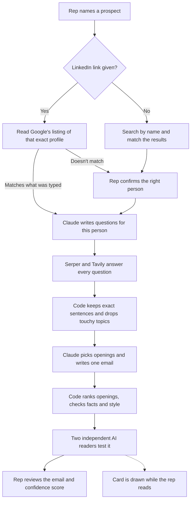

# Drafter

**Turn a prospect's name into a personal, fact-checked first email in about two minutes. A person reviews it before anything goes anywhere.**

Built for the AI Solutions Analyst case study, **PS-3: Personalised outreach, from prospect to draft**.

> A message that sounds generic gets deleted. A message that references something real gets a reply. The gap between the two is research, and nobody has 20 minutes per prospect.

Drafter closes that gap. A rep names a target. Drafter confirms who they are, works out what to ask about them, finds the answers, picks the strongest true opening, writes the email, tests it, and shows the rep how much to trust it.

## Why it's different

| Most AI outreach | Drafter |
|---|---|
| Fills a template with a name and a company | Passes a test where a reader, with names hidden, must pick out who the email was written for |
| Can invent a quote or a statistic | Every fact traces to a source, and code checks quotes and numbers word for word |
| Gives you text and leaves you guessing | Gives a confidence score with plain reasons for and against |
| Sends at scale | A person reviews every draft. Nothing sends by itself |
| Hard-wired to one product | Each account names its own company and product, and Drafter researches it |

## How it works



| Stage | What happens | Done by |
|---|---|---|
| Find the person | Searches by name, or reads Google's listing of an exact LinkedIn link | Serper, AI |
| Confirm | Nothing else runs until the rep agrees. Skipped when the link matches the typed details | Rep |
| Find email | Only if it was left blank. Never blocks the run | Hunter |
| Ask | Writes up to six questions for this person, based on what's being sold | AI |
| Search | Every question goes to both search services. LinkedIn is never opened | Serper, Tavily |
| Keep facts | Keeps exact sentences, and drops other people and touchy topics | Code |
| Choose and write | Rates the openings and writes the email in one step | AI |
| Rank | Weighted score, hard blocks and a threshold. Can overrule the AI's choice | Code |
| Test | Facts and style in code, then two separate readers. One rewrite at most | Code, AI |
| Card | A vector picture of the email's idea, drawn after the email is on screen | AI, code |
| Review | The rep edits, tries another opening, finishes, or sets it aside | Rep |

### AI suggests, code decides

The AI never has the last word on anything that matters. These are ordinary code:

- **Quotes** must appear word for word in a source.
- **Numbers** must appear in the fact they cite.
- **Customer results** must come from a list that was itself traced to a source.
- **Touchy topics** such as layoffs or lawsuits are blocked, even if the AI likes them.
- **The confidence score** is plain arithmetic, with limits. A weak link can't score above 65%. A general email can't score above 35%.

The writer also doesn't mark its own work. The readers are separate AI calls that never see its reasoning.

### Setting up what you sell

The first time someone signs up, they name their company and product. Drafter searches for it, asks them to confirm it's the right one, then researches it with the same question-and-search steps. It stores what the product does, who buys it, the signs that a company needs it, and any customer results it can prove. Each draft keeps the product it started with, so changing products never rewrites old work.

## Edge cases

| Situation | What Drafter does |
|---|---|
| Two people share a name | Shows both with sources, and waits for the rep |
| Someone has changed company | Flags it, and updates the prospect once the rep confirms |
| LinkedIn link shows a different person | Stops in seconds and shows only that profile |
| LinkedIn profile isn't on Google | Skips the name search, uses the typed details, and limits the score |
| Sensitive news about the person | Never used, and listed under "Ideas we left out" |
| A poor fit, or nothing to go on | Still writes, scores it low, and says why |
| A search service is down | Falls back to the other service or to saved results, and says so |
| The AI invents a quote | Code catches it, asks for one rewrite, then flags it for a closer look |
| The AI picks an opening code won't allow | Code overrules it and writes again |
| Same words on two sites | Counted once, not as two facts |

## The app

- **Live run view** showing each stage as it happens
- **Dashboard** of history, status and outputs under Past work
- **Sidebar** of drafts with rename, folders, pins, delete and redo
- **Encrypted private drafts**
- **Accounts**, each with its own drafts, product and settings
- **Gmail-style editor** with a designed card
- **Optional Gmail sending and scheduling**

## Tech

| Part | Choice |
|---|---|
| Server | Python, FastAPI, SQLite |
| Screens | Plain JavaScript, with live updates over server-sent events |
| Search | [Serper](https://serper.dev) and [Tavily](https://tavily.com) |
| Email finding | [Hunter](https://hunter.io) |
| AI | Claude, Gemini, or a local Claude Code login |
| Sending | Gmail API, with permission to send only |

## Run it

You'll need Python 3.11 or newer.

```powershell
python -m venv .venv
.\.venv\Scripts\pip install -r requirements.txt
copy .env.example .env      # then add your keys
.\.venv\Scripts\uvicorn app.main:app --reload --timeout-graceful-shutdown 2
```

Open http://127.0.0.1:8000. The last option matters: an open browser tab keeps a live connection, and without it the app can hang while restarting.

### Keys

| Setting | Needed? | What it's for |
|---|---|---|
| `TAVILY_API_KEY` | Yes | Reading full pages |
| `GEMINI_API_KEY` | Yes, unless using Claude Code | The AI work |
| `SERPER_API_KEY` | Recommended | Finding people and fast, dated results |
| `HUNTER_API_KEY` | Recommended | Finding work emails |
| `ANTHROPIC_API_KEY` | Optional | Claude takes over the hard thinking and writing |
| `AI_BACKEND=claude-code` | Optional | Uses your Claude Code login. Only works on the computer running the app |
| `GOOGLE_CLIENT_ID`, `GOOGLE_CLIENT_SECRET`, `TOKEN_KEY` | Only for sending | See below |

### Try it with no keys

```powershell
.\.venv\Scripts\python -m tests.preview
```

Open http://127.0.0.1:8765. Everything is made up and nothing can be sent. Make an account, enter any company and product, then try these:

| Enter | To see |
|---|---|
| Name `Sam Lee` | Two people with the same name |
| Company `Old Co` | Someone who has moved jobs |
| Company `Cutter` | Sensitive news left out |
| Company `Quiet` | Nothing found, so a general email with a low score |
| Company `Faraway` | A poor fit, scored honestly |

### Run the tests

```powershell
.\.venv\Scripts\pip install -r requirements-dev.txt
.\.venv\Scripts\python -m pytest
```

No test calls a real service or sends a real email.

## Sending from Gmail

Sending is optional. Without a connection, the Send and Schedule buttons stay hidden. Drafter only asks for permission to send, so it can never read an inbox.

1. In [Google Cloud Console](https://console.cloud.google.com/), create a project and enable the **Gmail API**.
2. Under **Google Auth Platform**, set the audience to **External** and add your Gmail as a **test user**.
3. Add the scope `https://www.googleapis.com/auth/gmail.send`.
4. Create an **OAuth client** of type **Web application**, with this redirect URI: `http://127.0.0.1:8000/api/gmail/callback`
5. Put `GOOGLE_CLIENT_ID`, `GOOGLE_CLIENT_SECRET` and a long random `TOKEN_KEY` in `.env`, then restart the app.
6. Open the app at `http://127.0.0.1:8000` (not `localhost`), go to **Settings**, and press **Connect Gmail**.

While the Google project is in Testing, the connection ends after 7 days and has to be made again.

Gmail's API has no way to send later, so Drafter holds scheduled emails and sends them itself. The app must be running at the chosen time. An email that would go out more than an hour late isn't sent, and the draft says why. Sending is never retried automatically, because a retry could deliver the same email twice.

## Security and privacy

- **Private drafts are encrypted** with AES-256-GCM. The key is unlocked only by the user's code, which is never stored, and the readable copy is wiped. If the code is lost, the draft can't be recovered.
- **Passwords and codes** are stretched with scrypt, and wrong guesses are slowed down.
- **Every draft and folder belongs to one account.** Someone else's draft behaves as if it doesn't exist.
- **Gmail connections** are stored encrypted.
- **AI-drawn card art** is rebuilt from a short list of allowed shapes and colours, so nothing unsafe reaches the page.
- **Web content is treated as information**, never as instructions.
- **LinkedIn is never opened directly.** Drafter only reads Google's public listing.

## Project layout

```text
app/
  main.py        Web routes and accounts API
  pipeline.py    The draft process, stage by stage
  product.py     First-time product setup and research
  profile.py     Reading an exact LinkedIn link through Google
  answers.py     Turns search results into provable facts
  checks.py      Fact, style and card checks, and the reader tests
  scoring.py     Opening scores, blocks and the confidence score
  verify.py      Quote, number and name matching
  prompts.py     Every AI instruction and answer format
  providers.py   Serper, Tavily, Hunter, Claude and Gemini
  art.py         Makes AI-drawn card art safe
  gmail.py       Gmail connection and the email itself
  outbox.py      Sending now, sending later, and exactly-once rules
  lock.py        Encryption for private drafts
  accounts.py    Passwords, sessions and limits on guessing
  db.py          SQLite storage
  samples.py     Test drafts for new accounts
static/          The screens
seller/          Example seller data and comparison profiles
tests/           Automated tests and the no-keys preview
```

## Put it online

`render.yaml` is ready for [Render](https://render.com). Connect the repo and enter your keys. Two things to know:

- Claude Code login only works locally, so a hosted copy needs `GEMINI_API_KEY` on a paid plan, or `ANTHROPIC_API_KEY`.
- The default disk is wiped on restart. Attach a disk and point `DATABASE_PATH` at it to keep accounts and drafts.

## Known limits

- **LinkedIn posts aren't read.** They'd make strong openings, but LinkedIn doesn't allow scraping.
- **Lesser-known people** may have little public information. Drafter says so through a lower score rather than padding the email.
- **Readers are AI stand-ins for people.** Only real reply rates prove an email works.
- **Timing and quality** have been measured on a small number of real runs, which reached a readable email in about one to two minutes.
- **Gmail sending** is covered by automated tests with a stand-in mailer, and needs a real connection tested on your own account.
- **The hosted AI route** is covered by tests with stand-ins. The real runs so far used a local Claude Code login.
- **Finding work emails** needs a privacy review before real commercial use.

## What's next

- Upload a list of prospects and draft them in a batch
- Learn from which emails actually get replies
- Add customer results by hand during product setup
- Licensed access to LinkedIn activity
